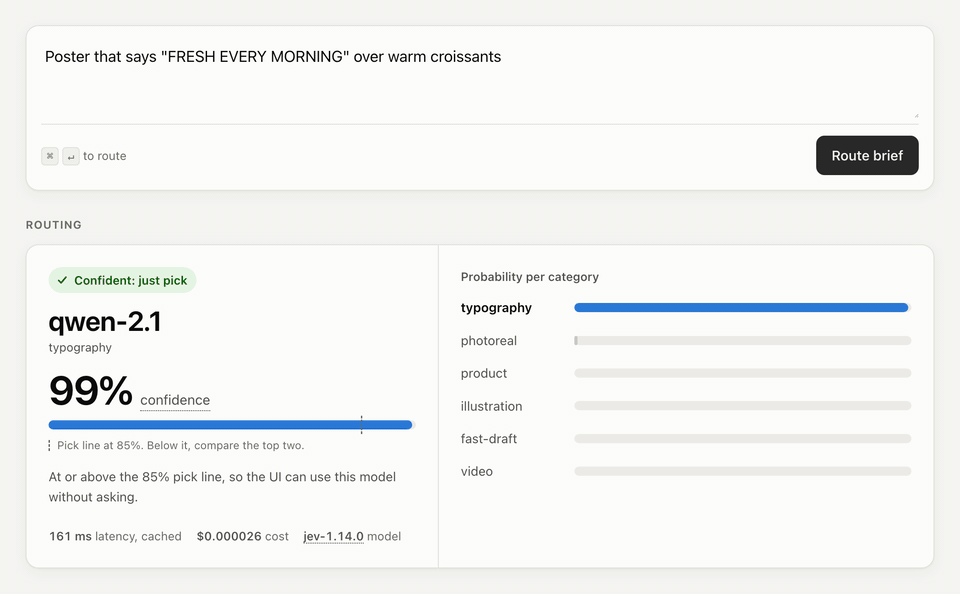
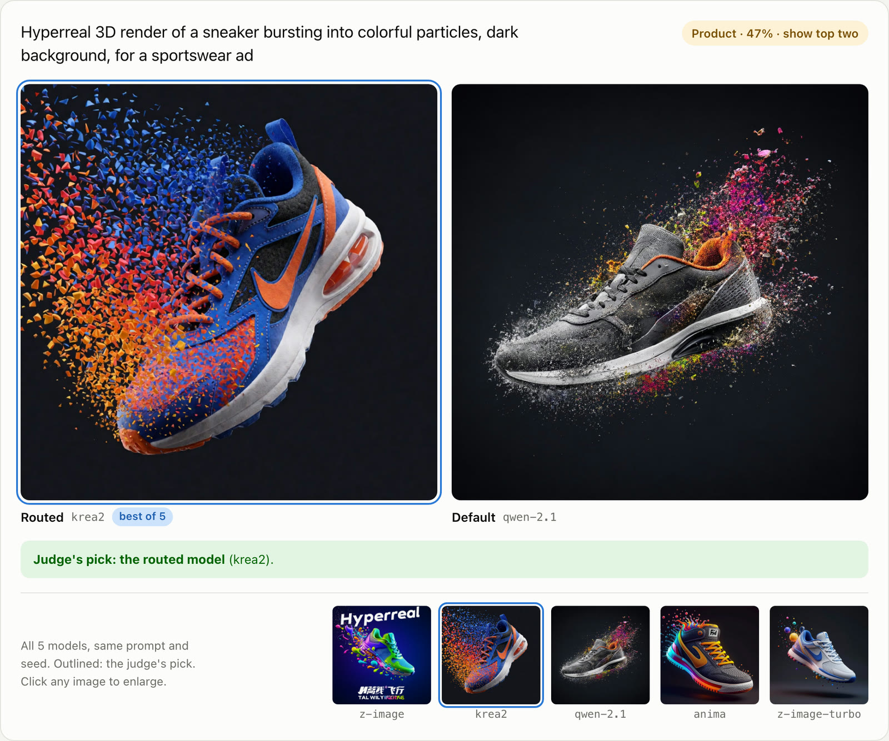
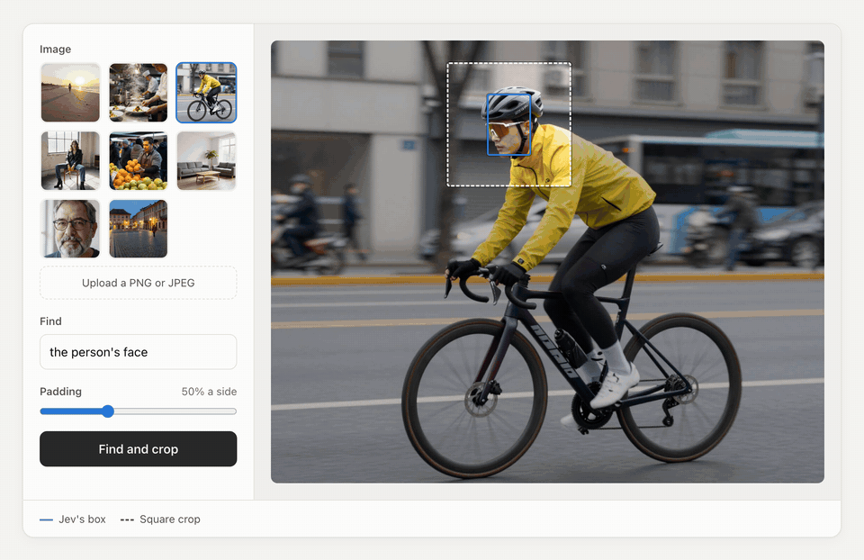

<p align="center">
  <picture>
    <source media="(prefers-color-scheme: dark)" srcset="docs/readme/wordmark-dark.png">
    
  </picture>
</p>

<p align="center">
  <b>Pick the right image model for a creative brief in about 200ms,<br>with a confidence you can trust.</b>
</p>

<p align="center">
  <a href="https://typecast-ai.vercel.app">Results</a> · <a href="https://typecast-ai.vercel.app/demo">Route a brief</a> · <a href="https://typecast-ai.vercel.app/locate">Find and crop</a>
</p>

<p align="center">
  <picture>
    <source media="(prefers-color-scheme: dark)" srcset="docs/readme/routing-dark.gif">
    
  </picture>
</p>

Media tools offer dozens of models, and users guess which one fits their brief.
Typecast asks a decision model (TypeSafe's Jev, or a Jev-compatible open model) for a typed, calibrated choice.
At 85% confidence or more the product just uses the pick; below that it shows the top two side by side.

## Results

On 240 held-out briefs, never tuned against, 3 runs each (`jev-1.14.0`):

| 604 / 604 | 113 / 116 | 207ms | $0.026 |
|:---:|:---:|:---:|:---:|
| confident picks were the right model | unsure routes had the right model in the top two | median time to route a brief | per 1,000 routes |

<details>
<summary>Per set</summary>

| Held out | Accuracy | ECE | Log-loss | Confident misses | p50 | p95 |
|---|---|---|---|---|---|---|
| `test` | 100% | 0.031 | 0.029 | 0 | 199ms | 307ms |
| `hard` | 91.7% | 0.050 | 0.210 | 0 | 214ms | 324ms |

`test` was written blind to the briefs we iterate on.
`hard` hides its deciding cue, so a keyword baseline that scores 85-88% elsewhere gets 9% on it.
Against the original prompt, the current one lifts `hard` from 83.1% to 91.7% and confident misses from 5.7 to 0 per run (McNemar p = 0.003).
</details>

### Does routing make better images?

Ten briefs, each rendered by all five local models with the same prompt and seed.
Jev, blind to which model made which, picked the routed model's image 7 times, the default's twice (chance is 2).
A small sample of briefs routing was tuned on, judged by Jev rather than people: a signal, not proof.

<p align="center">
  <picture>
    <source media="(prefers-color-scheme: dark)" srcset="docs/readme/shootout-dark.jpg">
    
  </picture>
</p>

## Find and crop

Name a target and one Jev request returns its box and whether it is there at all.
The page cuts a padded square around it, ready for a face or detail pass, in about 0.35s for $0.00016.
Box accuracy isn't measured yet; on nine samples it boxed every visible face.

<p align="center">
  <picture>
    <source media="(prefers-color-scheme: dark)" srcset="docs/readme/find-and-crop-dark.gif">
    
  </picture>
</p>

## Run it

```bash
cp .env.example .env        # add your TYPESAFE_API_KEY
npm install
npm run demo                # local web UI at http://localhost:4180
npm run route -- "Hero image for a spring sneaker campaign, studio lighting"
```

Point `TYPESAFE_BASE_URL` at a local Jev-compatible server (Kev, Laya, ...) to run without the hosted API.

<details>
<summary>Evaluate a change</summary>

```bash
npm run eval                                                   # accuracy, calibration, latency, cost
npm run eval -- --data data/test.jsonl --repeats 3
npm run compare -- runs/<default>.json runs/<candidate>.json   # paired deltas, bootstrap CIs, McNemar
```

ECE (Expected Calibration Error) asks whether 90% confidence is right 90% of the time.
`dev` is for iterating; `test` and `hard` are held out and scored only on final candidates.
</details>

<details>
<summary>Render and judge images (Apple Silicon)</summary>

```bash
uv tool install mflux
npm run generate                                   # routed vs default model on 50 dev briefs
npm run generate -- --shootout                     # every model on every brief
npm run judge -- runs/level2/<timestamp>           # blind side-by-side judging by hand
npm run judge-jev -- runs/level2/<timestamp>       # Jev judges every pair (about $0.0005 a pair)
npm run judge-report -- runs/level2/<timestamp>    # routed win rate with a 95% CI
npm run pick-jev -- runs/shootout/<timestamp>      # Jev picks the best of each brief
```

Set `HF_XET_HIGH_PERFORMANCE=1` for the first `generate`: it downloads about 100GB of weights.
</details>

<details>
<summary>Host the site</summary>

```bash
npm run site                # writes site/ and bakes the samples' answers into build/
vercel deploy               # a preview; add --prod to publish
```

Hosted, there is no Mac to render on, so the site routes and finds but doesn't render.
</details>
