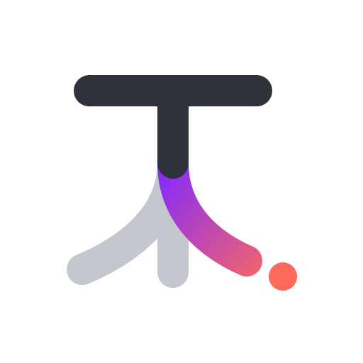

# Typecast

Pick the right image model for a creative brief — in ~200ms, with a confidence you can trust.

Built on decision models (TypeSafe's Jev and Jev-compatible open models) that return typed,
calibrated choices instead of text.

## Status
🚧 Level 1: measuring routing accuracy and calibration on labelled briefs.

## Quick start
```bash
cp .env.example .env        # add your TYPESAFE_API_KEY
npm install
npm run demo                # local web UI at http://localhost:4180
npm run route -- "Hero image for a spring sneaker campaign, studio lighting"
npm run eval                # runs data/dev.jsonl, prints accuracy + calibration
npm run eval -- --data data/test.jsonl --variant baseline --repeats 3
npm run compare -- runs/<baseline>.json runs/<candidate>.json   # paired deltas + CIs
```

### Level 2: does routing make better images?
Renders a fixed sample of briefs with the routed model and a single default model, locally on Apple Silicon via [mflux](https://github.com/mflux-community/mflux), then judges the pairs blind, by hand or with Jev reading both images.
```bash
uv tool install mflux
npm run generate                              # 50 dev briefs -> runs/level2/<timestamp>/
npm run judge -- runs/level2/<timestamp>      # blind side-by-side judging at http://localhost:4173
npm run judge-jev -- runs/level2/<timestamp>  # Jev judges every pair from the images (about $0.0005 a pair)
npm run judge-report -- runs/level2/<timestamp>  # routed win rate vs the default, with a 95% CI
npm run judge-report -- runs/level2/<timestamp> --judge jev  # Jev's win rate, and its agreement with yours
```
Set `HF_XET_HIGH_PERFORMANCE=1` for the first `generate`: it downloads about 100GB of weights, and the default downloader is several times slower on high-latency links.

### Showcase
A static one-page summary of the results, live at https://typecast-six.vercel.app.
```bash
npm run showcase              # writes site/ from the latest eval runs and picked shootout
vercel deploy site --prod
```

Point `TYPESAFE_BASE_URL` at a local Jev-compatible server (Kev, Laya, ...) to run without
the hosted API.

## How it's evaluated
| Metric | Question it answers |
|---|---|
| Accuracy | Does it pick the right model? |
| ECE (Expected Calibration Error) | When it says 90%, is it right 90% of the time? |
| p50 / p95 latency | How fast in practice? |
| Cost per 1,000 routes | What does it cost? |

Latest runs (2026-10-31, `jev-1.14.0`, default variant `priority`, 3 repeats each).
`dev` is the set we iterate on. `test` and `hard` are held out: `test` was written blind to dev, and `hard` was written so its deciding cue is implied rather than stated (a keyword baseline scores 85-88% on dev/test but 9% on hard).

| Metric | dev | test (held out) | hard (held out) |
|---|---|---|---|
| Accuracy | 98.3% | 100% | 91.7% |
| ECE | 0.035 | 0.031 | 0.050 |
| Log-loss | 0.062 | 0.029 | 0.210 |
| Confident misses (wrong at >= 0.85) | 0 | 0 | 0 |
| p50 / p95 latency | 199ms / 275ms | 199ms / 307ms | 214ms / 324ms |
| Cost per 1,000 routes | ~$0.026 | ~$0.026 | ~$0.026 |

Against the original `baseline` variant on `hard`: accuracy 83.1% -> 91.7%, log-loss 0.361 -> 0.210, confident misses 5.7 -> 0 per run (McNemar p = 0.003).
Every `priority` answer at >= 0.9 confidence on `hard` was right; its misses sit at 0.4-0.7 confidence, where a UI should show the top two.
